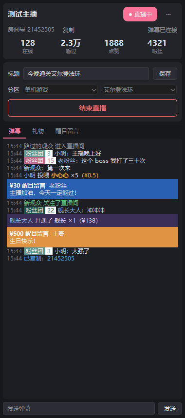

<div align="center">

# BiliLive for OBS

**不开直播姬，直接用 OBS 在 B 站开播。**

一个 OBS Studio 停靠窗口插件：扫码登录、改标题、选分区、一键开播和关播，<br>
弹幕、礼物、醒目留言、上舰都在 OBS 里看，也能直接发弹幕。

[](https://github.com/VOfficial404/obs-bililive/releases/latest)
[](https://github.com/VOfficial404/obs-bililive/actions)
[](LICENSE)

[下载](https://github.com/VOfficial404/obs-bililive/releases/latest) · [安装](#安装) · [使用](#使用) · [常见问题](#常见问题) · [English](#english)

</div>

<p align="center"></p>

## 为什么需要它

B 站规定粉丝数不足 5000 的主播只能用「哔哩哔哩直播姬」开播，网页上拿不到推流码，OBS 也就用不了。

这个插件在 OBS 里按直播姬 PC 版的方式向 B 站申请开播，拿到推流地址后直接写进 OBS 的推流设置，然后开始推流。画面、音频、编码器还是你熟悉的 OBS，不用再开第二个软件。

## 功能

- **扫码登录**：用哔哩哔哩 App 扫一下就登录，不用复制 Cookie。
- **一键开播 / 关播**：开播时自动把推流地址和推流码填进 OBS，并开始推流；在 OBS 里停止推流时自动关播（两项都能在菜单里关掉）。
- **标题、分区和公告**：开播前改标题、选分区，下次打开记住上次的分区；直播间公告也能直接在面板里改。
- **人脸认证**：分区要求人脸认证时弹出二维码，用 App 扫码认证后自动继续开播。
- **直播姬风格的面板**：深色界面、粉色开播按钮，在线/看过/点赞/粉丝一眼可见；弹幕带粉丝牌和主播、房管、舰长/提督/总督标签，醒目留言按金额显示成彩色卡片；「弹幕 / 礼物 / 醒目留言」分标签查看。
- **直播间封面**：面板左上角显示封面缩略图，点击即可上传新封面（B 站审核后生效）。
- **和其他弹幕姬一起用**：面板上一键复制房间号，填进 blivechat 等弹幕姬即可，互不影响。
- **弹幕悬浮窗**：玩游戏时不用切屏，弹幕直接浮在游戏上面；锁定后鼠标穿透，不影响操作；默认不会被直播画面拍进去。
- **直播数据**：看过人数、在线人数、点赞数、粉丝数。
- **发送弹幕**：在面板底部直接发弹幕。
- **没有直播间？** 插件里就能开通。
- 中文和英文界面跟随 OBS 的语言设置。

## 安装

需要 OBS Studio 31 或更新版本，**官网版、Steam 版、便携版都支持**。到 [Releases](https://github.com/VOfficial404/obs-bililive/releases/latest) 下载对应系统的安装包：

| 系统 | 文件 | 安装方式 |
|---|---|---|
| Windows（官网版、Steam 版） | `obs-bililive-*-windows-x64-setup.exe` | **双击安装**，一路下一步；升级时直接运行新版安装程序 |
| Windows（便携版） | 同上，或 `obs-bililive-*-windows-x64.zip` | 安装时把目录改成 OBS 文件夹下的 `plugins\obs-bililive`，见安装指南 |
| macOS（官网版、Steam 版） | `obs-bililive-*-macos-universal.pkg` | 双击安装 |
| Ubuntu 24.04 | `obs-bililive-*-x86_64-linux-gnu.deb` | `sudo apt install ./obs-bililive-*.deb` |

Steam 版请不要把插件放进 Steam 的 OBS 安装目录。每种情况的详细步骤、怎么判断自己用的是哪个版本、装了却看不到面板怎么办，见 **[安装指南](docs/INSTALL.md)**。

装好后重启 OBS，顶栏「工具」和「帮助」之间会多出一个 **B站直播** 菜单，点 **B站直播 → 显示面板** 打开面板（也可以在 **停靠窗口 → B站直播** 里打开）。

## 使用

1. 点 **扫码登录**，用哔哩哔哩 App 扫码并确认。
2. 填好标题，选好分区。
3. 点 **开始直播**。插件向 B 站申请开播，把推流地址写进 OBS，然后开始推流。
4. 播完点 **结束直播**，或者直接在 OBS 里点「停止直播」。

顶栏的 **B站直播** 菜单和面板右上角的 **⋯** 菜单内容相同，可以：

- 显示面板、开始或结束直播；
- 关掉「开播后自动开始推流」，改为手动点 OBS 的「开始直播」；
- 关掉「OBS 停止推流时自动关播」，断流重推时直播间不会下播；
- 隐藏进场和礼物消息；
- 打开直播间、复制房间号或直播间链接、刷新、退出登录。

> 每次开播 B 站都会生成新的推流码，所以请用面板上的「开始直播」开播，而不是直接点 OBS 的「开始直播」。

### 弹幕悬浮窗

在 **⋯ → 弹幕悬浮窗** 里勾选「显示悬浮窗」，屏幕上会出现一个半透明的弹幕窗口，始终显示在其他窗口上面：

1. **摆位置**：没锁定时窗口带虚线边框，按住任意位置拖动，拖右下角调整大小。
2. **锁定**：勾选「锁定（鼠标穿透）」后边框消失，鼠标点击会直接穿过悬浮窗落到游戏上。
3. **外观**：在同一个菜单里调背景不透明度（0% 为完全透明，只留带描边的文字）、字号和弹幕淡出时间。默认每条弹幕 30 秒后淡出，和直播姬一样；也可以改成 10、20、60 秒或不淡出。
4. **快捷键**：在 OBS 的「设置 → 快捷键」里给「B站直播：显示/隐藏弹幕悬浮窗」和「B站直播：锁定/解锁弹幕悬浮窗」设置按键。OBS 在后台也能响应快捷键，打游戏时不用切出来。

悬浮窗顶部显示在线人数和看过人数；进场和礼物消息是否显示，跟面板的设置一致。位置、大小和外观会被记住。

**不会被直播画面拍进去**：在 Windows 10 2004 及以上，「不让直播画面拍到悬浮窗」默认开启，即使用「显示器采集」采集整个屏幕，悬浮窗也不会出现在直播里，只有你自己看得到。macOS 和 Linux 没有这个功能，请用「窗口采集」只采集游戏窗口，不要采集整个屏幕。

## 常见问题

**能和 blivechat 等其他弹幕姬一起用吗**
能。其他弹幕姬自己按房间号连接 B 站，和插件互不影响。点面板上房间号旁边的「复制」，或者菜单里的「复制房间号」，填进去就行。插件自带的悬浮窗默认是关的，不想用可以一直不开。

**提示需要人脸认证（60024）**
部分分区开播前要人脸认证。插件会弹出二维码，用哔哩哔哩 App 扫码完成认证后会自动继续开播。

**提示额外的身份验证（60043）**
这是另一种风控验证，插件还不支持。在直播姬里开播一次完成验证，之后就能继续用插件开播。

**推流失败或画面卡住**
B 站并没有给所有主播开放 HEVC（H.265）推流。请在 OBS 的「设置 → 输出」里把编码器换成 H.264（x264、NVENC H.264 等）。

**开播后 B 站显示的开播工具是「直播姬」**
插件就是以直播姬 PC 版的身份开播的，这是正常的。

**游戏里看不到悬浮窗**
独占全屏的游戏会盖住所有其他窗口。把游戏的显示模式改成「无边框窗口」或「窗口化全屏」。

## 注意

- 这是第三方工具，与哔哩哔哩无关。B 站随时可能修改接口，插件因此暂时失效时请到 [Issues](https://github.com/VOfficial404/obs-bililive/issues) 反馈。
- 使用第三方工具开播可能违反 B 站的用户协议，由此产生的风险由使用者自行承担。
- 登录凭据（`SESSDATA`、`bili_jct`）：Windows 上用系统的 DPAPI 加密后保存在 OBS 配置目录下的 `plugin_config/obs-bililive/config.json`，只有当前 Windows 用户能解密；macOS 上存在「钥匙串」里；Linux 上以明文保存在该文件中，文件只有你自己能读。不要把这个文件发给别人；不用了就在插件里点「退出登录」，凭据会被作废并清除。
- 插件只和 B 站的服务器通信，不收集任何数据。

## 从源码构建

本项目基于 [obs-plugintemplate](https://github.com/obsproject/obs-plugintemplate)，依赖 libobs、obs-frontend-api、Qt 6（Core、Widgets）和 libcurl。

```sh
# Windows（Visual Studio 2022）
cmake --preset windows-x64
cmake --build --preset windows-x64

# macOS（Xcode 16）
cmake --preset macos
cmake --build --preset macos

# Ubuntu 24.04
cmake --preset ubuntu-x86_64
cmake --build --preset ubuntu-x86_64
```

单元测试覆盖签名、弹幕协议和消息解析：

```sh
cmake --preset ubuntu-x86_64 -DENABLE_TESTS=ON
cmake --build --preset ubuntu-x86_64 --target bililive-tests
ctest --test-dir build_x86_64
```

更多说明见 [CONTRIBUTING.md](CONTRIBUTING.md)。

## 致谢

- [bilibili-API-collect](https://github.com/SocialSisterYi/bilibili-API-collect)：B 站接口文档
- [StartLive](https://github.com/Radekyspec/StartLive)：直播姬开播流程的参考实现
- [QR Code generator library](https://github.com/nayuki/QR-Code-generator)：二维码生成（MIT）
- [puff](https://github.com/madler/zlib/tree/develop/contrib/puff)：zlib 作者写的精简解压器，用来解压弹幕（zlib 许可）

## 许可

[GPL-2.0-or-later](LICENSE)

---

## English

**BiliLive for OBS** lets you go live on Bilibili straight from OBS Studio. Bilibili only lets streamers with fewer than 5,000 followers start a broadcast from its LiveHime app; this dock starts the broadcast the way LiveHime does, writes the RTMP address into OBS and starts streaming.

Features: QR-code login, title and category, one-click go live / end broadcast (synced with OBS's own Start/Stop Streaming), face verification by QR code, a live feed of danmaku, gifts, Super Chats, guard purchases, follows and entries, viewer statistics, sending danmaku, and an always-on-top, click-through danmaku overlay for reading chat in-game (kept out of display capture on Windows 10 2004+, with OBS hotkeys to show and lock it).

Install the package for your platform from [Releases](https://github.com/VOfficial404/obs-bililive/releases/latest), restart OBS and use the new **Bilibili Live** menu in the menu bar (between Tools and Help) → **Show panel**. Requires OBS Studio 31 or newer; the website, Steam and portable builds are all supported. On Windows (website and Steam builds) put the `obs-bililive` folder in `C:\ProgramData\obs-studio\plugins\`, not in the OBS or Steam install directory. Details for every build are in the [install guide](docs/INSTALL.md) (Chinese).

This is an unofficial tool, not affiliated with Bilibili. Using it may breach Bilibili's terms of service; you use it at your own risk. The login session is encrypted with DPAPI on Windows and kept in the Keychain on macOS; on Linux it is stored in plain text in `plugin_config/obs-bililive/config.json` under the OBS configuration directory, readable only by your user.
